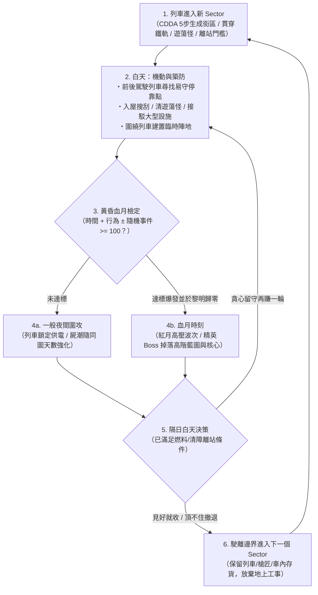

# 遊戲設計文件（GDD）v2.0 — 甲鐵廢墟戰線（暫名：`mygame`）

- **版本**：v2.0（正式定錨「晝夜移動列車防線 × CDDA 五步隨機街區 × 血月雙軌事件 × 槍匠永久養成 × 冷峻戰術動漫美學」）
- **引擎與視角**：Godot 4（GDScript）／雙俯瞰視角即時切換（45° Project Zomboid 正交等角 ／ RO 透視）
- **核心類型**：俯瞰戰術射擊 × 移動列車晝夜據點防守 × CDDA 模組都市搜刮遠征 × 槍匠／列車永久養成
- **關聯文件**：[GLOSSARY.md](../GLOSSARY.md) ｜ [ADR-0006](adr/0006-uncharted-waters-inspired-train-carriage-customization.md) ｜ [ADR-0007](adr/0007-day-night-mobile-train-cdda-city-gunsmith.md) ｜ [民防住家資產規格書](ASSET_SPEC_CIVIL_HOUSES.md) ｜ [ASSETS.md](../ASSETS.md)

---

## 1. 一句話定位（High Concept）

> **駕駛你的裝甲列車在白天駛入隨機生成的冷峻末日都市街區，沿貫穿城市的鐵軌尋找易守難攻的停靠位置，圍繞列車建立臨時防禦陣地並接駁大型設施；在不斷升溫的夜間屍潮圍攻與血月危機中選擇「貪心留守榨取高階戰利品」或「破障發車前往下一座城市」，並在遠征之間透過槍匠系統與列車改造永久變強。**

---

## 2. 核心玩法支柱（Anchored Design Pillars）

1. **CDDA 五步隨機街區 × 貫穿式鐵軌戰術地形**
   - 採用參考《Cataclysm: DDA》的五步管線生成街區（從民防住家建築起步），讓建築具有可進入的客廳／廚房／臥室／衛浴室內空間（配合自動屋頂切頂）與廢墟濾鏡質感。
   - **鐵軌貫穿城市**：鐵軌在 Overmap 階段即貫穿街區，自然形成窄道峽口、貨運月台、平交道十字路口等防守條件截然不同的停靠點。
2. **晝夜雙節奏 × 白天列車機動選點**
   - **白天（Day）**：視野良好，列車可沿鐵軌**前進或後退**尋找最佳防禦點並停駐，玩家出門搜刮物資、清理零散遊蕩怪、接駁大型設施與架設臨時陣地。
   - **黃昏與夜晚（Dusk & Night）**：入夜後鍋爐轉供全車防禦電力（列車鎖定無法移動），視野收斂、手電與探照燈成為剛需；成群怪物從四面湧向列車當前停靠位置發起圍攻。
   - **同圖威脅成長**：在同一張地圖待得越久，夜間怪物數量、生命與特殊變異體比例越高。
3. **「血月時刻」雙軌累積 ＋ 隨機事件機制**
   - 血月值（`0～100`）由 **時間累積（可預測基礎推進）＋ 行為累積（高噪音槍戰／啟動設施／清剿巢穴額外灌注）＋ 隨機異常事件增減** 共同驅動。
   - 黃昏檢定達 `100` 即拉響警報、入夜進入紅月高壓圍攻，考驗陣地極限並產出高階永久強化核心。
4. **留守誘因（Stay-vs-Leave 張力）**
   - **下限推力**：進站面臨離站燃料需求或前方鐵軌路障清理門檻，確保至少經歷 1～2 個晝夜防守。
   - **設施拉力**：地圖內的大型固定設施須將列車停靠鄰近供電，隨停留天數提供階梯暴增的高階產出，換圖即斷線放棄。
   - **夜戰與血月刷寶**：白天遊蕩怪僅提供維持消耗的基礎補給；稀有武器藍圖、特種配件與改造核心主要來自夜間精英與血月掉落。
   - **陣地沉沒成本**：地上沙包、拒馬與固定砲塔無法整座打包帶走，使「繼續守住已成形的銅牆鐵壁」成為合理且刺激的貪心抉擇。
5. **永久成長：槍匠系統優先 × 列車橫切面改造**
   - **第一階段主打槍匠系統（Gunsmith）**：武器解鎖、基礎強化、戰術配件（消音器降低開火警戒圈並減緩血月值累積 vs 制退器增傷；穿甲彈匣 vs 擴容彈鼓；戰術強光手電）。
   - **列車編成改造**：承接現有《大航海時代》式車頭／車廂擴建／艙格改造／乘員派駐系統（見 [ADR-0006](adr/0006-uncharted-waters-inspired-train-carriage-customization.md)）。

---

## 3. 核心遊戲循環（Anchored Core Loop）

---

## 4. 隨機地圖管線設計（CDDA 五步法 × 民防住家建築 MVP）

詳見 [民防住家建築 45～55 件模組化資產規格書](ASSET_SPEC_CIVIL_HOUSES.md)：

1. **Step 1 — 房間 Block 庫（Nested Room Blocks & Palettes）**：預定義 `6×6` 或 `4×4` 子格（`1.6m` 單位）獨立房間模組（客廳、廚房、臥室、衛浴、玄關），家具預設 `Socket` 掛點。
2. **Step 2 — 建築配方與拓撲**：先實作「普通民防住家民房」多變體配方，將房間 Block 填入建築輪廓並連結室內門框，屋頂自動綁定 `RoofCutaway` 群組實現進屋切頂可視。
3. **Step 3 — Overmap 道路網與貫穿鐵軌**：先鋪設貫穿整張 Sector 的鐵軌廊道，再生成主幹道與次級道路劃分街區，建立路口與鐵道沿線防守節點。
4. **Step 4 — 沿街生成與朝向對齊**：依鄰近道路格自動旋轉建築朝向（`0°/90°/180°/270°`）使大門臨路；內側無臨路區域填充庭院、停車場或荒地。
5. **Step 5 — 全局廢墟化濾鏡**：
   - `ter_furn_transforms`：依損毀率替換破牆、碎窗、歪斜門與木板封窗。
   - 瓦礫堆（Rubble）＋ 程式 `90°` 旋轉翻倒剛體家具作為掩體。
   - **World-Space Noise Shader** 自動疊加冷灰塵埃、水漬與鏽蝕 ＋ **Godot `Decal`** 投射地面裂縫／血跡／焦痕／紙張（零尋路干擾）。

---

## 5. 美術與介面定調：《少女前線2：追放》冷峻戰術動漫風

- **場景與角色對接**：動漫人形角色（`SummerCuteness` / `Aria Idol` / `Nangong Yu`）＋ 寫實軍武模型（M4A1-S / AK-47 / Desert Eagle）＋ 乾淨幾何結構與半風格化冷灰調環境光，搭配極冷月夜與暖色列車探照燈拉出高對比戲劇光影。
- **UI 設計系統（`TacticalTheme`）**：深石板黑半透明底（`#0E131A`）、1px 鋼灰細框線、0～2px 銳利導角、非對稱工業琥珀／全息青邊條、清晰戰術編碼標籤與低噪數據排版。

---

## 6. 已完成原型基線 & 新階段開發路線圖（Roadmap）

### 已完成技術基線（Baseline @ v1.x）
- [x] Godot 4 核心架構、無頭自動化測試套件（`tests/run_tests.gd`，223 項驗證通過）
- [x] 單人直控 × Mixamo 12 支動捕骨骼重定向 × 雙視角切換（Zomboid 正交 / RO 透視）
- [x] 三武器切換（M4A1-S / AK-47 / Desert Eagle）、獨立音效池與彈道槍口校準
- [x] 4 種地上防禦工事（沙包 / 拒馬 / 地雷 / 固定砲台）、可進入切頂列車與橫切面改裝介面
- [x] 冷峻戰術科技風 UI 改版（`TacticalTheme` 統一全 HUD / 藍圖 / 選單 / 沙盒介面）

### Milestone 0：設計定錨與規格確立（✅ 已完成）
- [x] 確立核心玩法、血月雙軌規則、C 方案留守誘因與槍匠優先順序（[ADR-0007](adr/0007-day-night-mobile-train-cdda-city-gunsmith.md)）
- [x] 完成 `GDD v2.0`、`GLOSSARY.md` 與 [民防住家資產規格書](ASSET_SPEC_CIVIL_HOUSES.md)

### Milestone 1：CDDA 五步街區生成器 MVP ＋ 貫穿鐵軌（✅ 已完成）
- [x] 實作 `1.6m` 室內子格網與 Step 1～5 生成管線（含可替換 `assets/packs/civil_houses/*.glb` 介面與冷峻程序化預設模型）
- [x] 實作貫穿整張地圖的鐵軌廊道與沿線多樣化防守地形（夾道窄口、平交道、貨運空地）
- [x] 實作建築屋頂自動切頂透視（`RoofCutaway`）、`World-Space Noise` 髒污著色器與 `Decal` 貼花濾鏡

### Milestone 2：晝夜循環系統 ＋ 白天鐵軌雙向行駛（✅ 已完成）
- [x] 實作 `Day / Dusk / Night / BloodMoon` 全局時鐘與動態天光／霧效（手電與列車探照燈夜戰實裝）
- [x] 改造 `ArmoredTrainBase`，支援白天沿鐵軌前進／後退／煞停與車廂跟隨；入夜鎖定供電切入防禦模式

### Milestone 3：雙層怪物生態 ＋ 血月雙軌系統（✅ 已完成）
- [x] 實作白天室內外遊蕩怪 AI（視線與槍聲警戒圈，支援進屋推門遭遇戰）
- [x] 實作夜間多向圍攻屍潮（鎖定列車當前停靠座標，強度隨同圖停留天數成長）
- [x] 實作血月計量條（時間累積 ＋ 行為累積 ± 隨機事件）、黃昏預警與血月精英掉落

### Milestone 4：長期堅守設施 ＋ 陣地維護 ＋ 跨圖遠征（✅ 已完成）
- [x] 實作需列車停靠接電的「大型留守設施」（跨日階梯高階產出）與「離站燃料／鐵軌清障門檻」
- [x] 實作白天駛離地圖邊界切換下一張隨機 Sector 的連續遠征流（保留列車與車內物資，清空地上工事）
- [x] 擴充工事維護機制：修復、換點局部拆遷回收、封窗木板與探照燈柱

### Milestone 5：永久成長第一彈 — 槍匠系統（Gunsmith）
- [ ] 實作槍匠整備介面與持久化解鎖（擴充武器庫：霰彈槍、輕機槍、穿甲步槍等）
- [ ] 實作配件槽位（消音器降噪減緩血月值 vs 制退器增傷／穿甲彈匣／擴容彈鼓／高流明戰術燈）
- [ ] 串接多日設施與血月精英的稀有藍圖／改造核心掉落閉環
