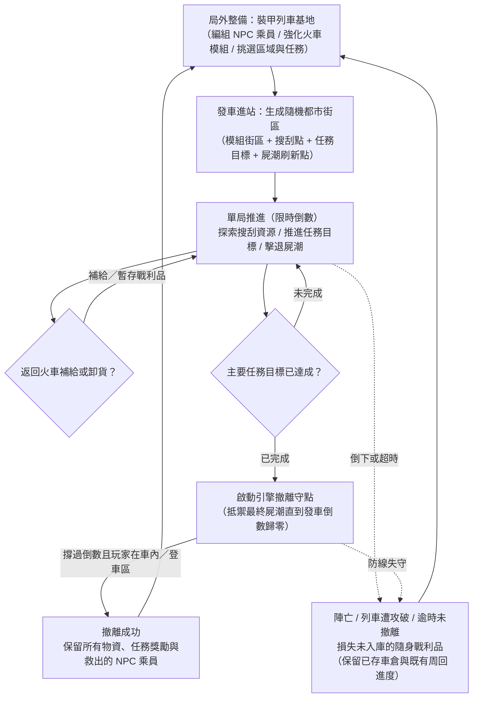

# 遊戲設計文件（GDD）v1.0 — 裝甲列車撤離戰線（暫名：`mygame`）

- **版本**：v1.0（核心玩法重塑與 Godot 4 現成素材管線定案）
- **引擎與視角**：Godot 4（GDScript）／雙俯瞰視角即時切換（45° Project Zomboid 正交等角 ／ RO 透視）
- **核心類型**：俯瞰動作射擊 × 隨機街區搜刮撤離（Extraction）× 裝甲火車防禦與周回養成（Roguelite Meta-Progression）
- **核心關聯文件**：[GLOSSARY.md](../GLOSSARY.md) ｜ [ADR-0005](adr/0005-gameplay-pivot-train-extraction-horde-and-external-assets.md) ｜ [ASSETS.md](../ASSETS.md)

---

## 1. 一句話定位（High Concept）

> **駕駛你的裝甲火車駛入每一局隨機生成的末日都市街區，在倒數計時與不斷升級的屍潮壓迫下，完成指定任務、搜刮資源並活著搭車撤離；在周回之間招募 NPC 乘員並持續改裝強化火車，挑戰更危險的深層區域。**

---

## 2. 核心支柱（Design Pillars）

1. **每局隨機都市街區（Procedural Urban Sector）**
   - 每次出擊都由 **Kenney Retro Urban Kit** 模組化街區區塊（道路、十字路口、三層工廠、紅磚店舖、貨運院子、公園、死巷與搜刮點）依種子（Seed）程序生成，並在地圖邊緣配置裝甲火車停靠月台與鐵軌。
   - 隨機配置確保路線、掩體、物資點、任務目標與屍潮來襲方向每局皆有新鮮感與決策張力。
2. **裝甲火車即是移動基地（Armored Train Base）**
   - 裝甲火車不只是背景裝飾，而是單局內的**安全錨點、物資入庫處、防禦火力點與唯一撤離載具**，也是局外周回養成的核心載體。
   - 玩家可在搜刮途中折返火車卸貨、補給彈藥與回血，也可把屍潮引回火車砲塔射界內協同防守。
3. **限時壓力 × 任務導向 × 屍潮升級（Timed Extraction & Escalating Horde）**
   - 每局皆有明確的**限時倒數**與**威脅等級階梯**（從零星遊蕩屍群 → 定期小波屍潮 → 引擎啟動時的最終撤離守點屍潮）。
   - 貪心搜刮更多資源 vs. 提早完成任務安全撤離，構成核心風險報酬（Risk-Reward）抉擇。
4. **周回成長：NPC 乘員 × 火車強化（Meta-Progression）**
   - 單局帶回的資源與救援出的倖存者將永久累積至周回進度：
     - **收集與編組 NPC 乘員**：進駐火車各車廂崗位，解鎖主動支援或被動強化。
     - **強化裝甲火車**：提升裝甲耐久、架設／升級自動防禦砲塔、強化鍋爐引擎、擴建工坊／醫療／貨倉車廂。

---

## 3. 雙層遊戲循環（Core & Meta Game Loop）

---

## 4. 單局玩法設計（In-Run Gameplay）

### 4.1 隨機地圖生成（Procedural Sector Generation）
地圖以 `TILE = 3.2m` 為基礎格網（對應 Kenney Retro Urban Kit 標準比例），由**街區區塊（Chunk / Block）**拼接而成：

| 地圖區塊類型 | 功能與視覺特色 | 遊戲性意義 |
| :--- | :--- | :--- |
| **鐵軌與月台帶（Train Track Edge）** | 固定位於地圖一側，停靠玩家的裝甲火車與防禦前哨 | 出發點、補給點、最後撤離守點與火車砲塔射界 |
| **主幹道與十字路口（Main Roads）** | 寬闊柏油路、廢棄車輛與路障 | 視野開闊、適合拉打與翻滾走位，但也是屍潮推進主線 |
| **工業工廠區（Industrial Block）** | 鋸齒屋頂工廠、鷹架塔、貨櫃與圍籬院子 | 高機率產出鋼鐵建材、燃料與火車改裝零件 |
| **商業街區（Commercial Block）** | 紅磚店舖、人行道、街角小店 | 產出醫療物資、彈藥箱與任務關鍵物件 |
| **住宅／公園／死巷（Park & Alleys）** | 秋樹公園、狹窄巷弄與圍牆 | 可繞路切斷屍群追擊，也可能藏有受困 NPC 或補給箱 |

- **可重現種子（Seed）**：每局自動產生隨機種子，亦支援測試模式指定 Seed 除錯地圖生成與導航。
- **導航與掩體**：所有建築與障礙自動附帶物理碰撞與導航阻擋，確保喪屍群繞行街角而不會穿牆。

### 4.2 裝甲火車基地（單局內職能）
在單局中，停靠於月台的裝甲火車具備四項即時功能：
1. **安全出發與登車區（Boarding Zone）**：玩家由車廂出發；撤離時需回到登車區啟動發車並待到列車離站。
2. **隨身物資暫存庫（Train Stash）**：玩家背包容量有限，途中可跑回車邊按互動鍵把已收集的珍貴材料存入車倉（一旦入庫，即使後續任務失敗也可依規則保底部分或全數保留，鼓勵中段折返決策）。
3. **彈藥補給與簡易休整（Resupply & Heal）**：消耗車上儲備或受惠於醫療／軍械乘員，恢復生命值與彈藥。
4. **主動防禦陣地（Train Defense）**：
   - 車身具備獨立**列車裝甲值（Train Hull HP）**；當屍潮逼近月台時會攻擊車體與防禦工事。
   - 依玩家的周回強化配置，車頂自動機槍塔、探照燈（擴大視野／減速）或電網護欄會自動協助清除靠近的喪屍。

### 4.3 限時機制與屍潮節奏（Timer & Horde Escalation）
單局標準時長設定為 **6～10 分鐘**（依地圖難度調整），隨時間推進分為四個階段：

| 階段 | 時間佔比（範例：8 分鐘局） | 威脅狀態與環境回饋 |
| :--- | :--- | :--- |
| **階段 1：靜默進站** | 00:00 – 02:30 | 零星遊蕩喪屍巡邏街區；適合快速偵查地形、搜刮外圍物資並接近任務點 |
| **階段 2：警報升溫** | 02:30 – 05:30 | 觸發第一波小型屍潮（每 60～90 秒一波），同時出現奔跑型／特殊喪屍；黃昏光影加深 |
| **階段 3：紅月／夜幕屍潮** | 05:30 – 08:00 | 屍潮密度與速度顯著提高，街區四面刷新並開始主動逼近火車月台 |
| **最終階段：撤離發車守點** | 啟動撤離後 30～45 秒 | 玩家於火車觸發「啟動鍋爐發車」後，汽笛聲引來**最終高壓屍潮**；撐過倒數且位於車內／登車區即撤離成功（升級引擎可縮短發車時間） |

> **逾時懲罰**：若倒數歸零仍未啟動撤離，街區將進入「無限滅絕屍潮」狀態（不再限制刷怪且喪屍狂暴），逼迫玩家立即衝回車上緊急發車。

### 4.4 單局任務目標（Mission Objectives）
每局開圖時隨機指派 **1 個主線撤離任務**（必須完成才能啟動正規撤離）與 **0～2 個選擇性支線目標**（提供額外高價值獎勵或 NPC 乘員）：

- **主線任務類型（MVP 優先實作前 3 種）**：
  1. **燃料回收（Fuel Recovery）**：於街區指定工業點搜刮並運回 `N` 個高能燃料電池至火車鍋爐。
  2. **訊號中繼修復（Relay Repair）**：前往 `2～3` 處廢棄中繼站長按互動完成修復（修復期間會觸發局部屍潮圍攻）。
  3. **關鍵黑盒／物資奪還（Cargo Retrieval）**：突破高密度屍群封鎖區，取得關鍵機密箱帶回火車。
  4. **巢穴清除（Nest Purge）**：摧毀街區內的畸變母巢以清空鐵路前進阻礙。
- **支線／高價值事件**：
  - **受困倖存者救援（Survivor Rescue）**：於街區隨機封鎖建築發現求救訊號，清除周圍喪屍並護送／引導其撤回火車 → **成功撤離後直接加入成為永久 NPC 乘員**！
  - **高危空投／軍械箱**：開啟需要長按互動且發出噪音，獎勵稀有改裝藍圖或高階武器素材。

### 4.5 玩家戰鬥與操作手感（Solo Player Action）
保留並深化目前已完成驗證的單人角色操作與雙視角手感：
- **單人直接操控**：移除跟隨 AI 隊友，所有走位、瞄準、翻滾與互動聚焦於玩家自身，節奏更俐落清晰（NPC 乘員以「火車崗位駐守與支援技能／砲塔操控」呈現，不搶奪玩家操作焦點）。
- **核心操作**：
  - 移動：`WASD`（自動對齊當前鏡頭朝向）或右鍵點地移動。
  - 360° 瞄準與射擊：滑鼠游標瞄準，左鍵連射，含後座力、彈匣管理與換彈節奏。
  - 戰術翻滾：`Space` / `Shift`（無敵幀＋短暫冷卻，用於閃避屍潮撲擊與脫離包圍）。
  - 互動／搜刮／搬運：`E` / `F` 長按互動條。
  - 鏡頭切換：`O` 鍵即時切換 **Project Zomboid 45° 正交等角視角** 與 **RO 透視視角**；支援鎖定跟隨／自由移鏡（`Y`）與滾輪縮放。

---

## 5. 周回成長系統（Meta-Progression）

每次撤離回到列車整備畫面後，玩家運用帶回的資源與人力進行永久養成，迎接更深層的危險區域：

### 5.1 收集與編組 NPC 乘員（NPC Crew Roster）
NPC 乘員透過**局內救援事件**或**達成特定任務里程碑**解鎖，可指派至火車對應車廂崗位（初期解鎖 2 個崗位，隨車廂擴建開放更多槽位）：

| 乘員職能（Role） | 駐守車廂 | 單局內提供的核心能力／增益 |
| :--- | :--- | :--- |
| **砲手（Gunner）** | 裝甲砲塔車廂 | 進駐後顯著提升車頂自動砲塔射速、精準度與優先鎖定特殊喪屍能力 |
| **輪機工程師（Mechanic）** | 蒸氣鍋爐車頭 | 縮短撤離發車暖機倒數時間、自動緩慢修復列車裝甲耐久 |
| **戰地醫護（Medic）** | 醫療車廂 | 玩家返回火車時快速回復生命值，並提升隨身醫療包攜帶上限／治療量 |
| **偵察手（Scout）** | 瞭望塔／通訊車廂 | 開局即在地圖／方向指示器上標記任務點、高階物資箱與受困倖存者位置 |
| **軍需官（Quartermaster）** | 貨運／軍械車廂 | 擴大隨身背包與火車暫存倉容量，出擊時提供免費初始彈藥與投擲物 |

> 乘員可帶有簡易稀有度／個人特性詞條（例如「重機槍專精」、「快速裝填」、「撿垃圾達人」），增添周回收集與搭配樂趣。

### 5.2 強化裝甲火車（Armored Train Upgrades）
使用單局帶回的資源（**廢金屬 Scrap**、**精煉零件 Parts**、**燃料結晶 Fuel**、**醫療／軍規核心 Core**）分模組升級火車：

| 升級系統 | 升級效果 | 視覺回饋（逐步實裝） |
| :--- | :--- | :--- |
| **重裝車體與排障器（Hull & Plow）** | 提高列車裝甲上限與減傷，提升被屍潮圍攻時的容錯 | 車身附加鉚釘裝甲板與強化破障鏟 |
| **防禦武裝（Roof Turrets & Defenses）** | 解鎖並升級車頂機槍塔、霰彈近防塔、高壓電網或探照燈 | 車頂出現實體砲塔並具備實際射擊曳光與轉動 |
| **鍋爐引擎（Engine & Boiler）** | 縮短最終撤離發車倒數時間、解鎖更遠的高風險都市區域（Tier 2 / Tier 3） | 煙囪火力更強、車體爐心亮度提升 |
| **工坊與軍械庫（Armory Car）** | 解鎖與升級玩家出擊攜帶的主副武器、彈匣容量、護甲與手榴彈 | 整備介面與車廂工作台外觀升級 |
| **乘員宿舍與貨倉（Crew & Cargo Cars）** | 增加可同時編組的 NPC 乘員槽位數與局內車倉安全保存格數 | 列車總車廂節數實質加長 |

---

## 6. 資源與經濟循環（Economy）

| 資源類型 | 取得途徑 | 主要用途 |
| :--- | :--- | :--- |
| **廢金屬（Scrap）** | 拆解街區雜物、工業箱、擊殺屍潮掉落 | 火車裝甲強化、彈藥補充、基礎工事 |
| **機械零件（Parts）** | 工廠區、車輛殘骸、中繼站與任務獎勵 | 砲塔升級、引擎改造、武器強化 |
| **高能燃料（Fuel）** | 工業油槽、燃料回收任務 | 單局發車／進入高階區域門票、鍋爐升級 |
| **醫療與補給品（Supplies）** | 商業街區、藥局／救護車 | 局內回血、醫療車廂升級與乘員招募維護 |
| **受困倖存者（Crew）** | 街區支線救援事件並成功撤離 | 永久加入 NPC 乘員名冊，指派至列車崗位 |

---

## 7. 敵人設計（Zombie Horde Archetypes）

MVP 階段先以明確區分剪影、速度與威脅的 4 種喪屍為目標：
1. **漫遊者（Walker）**：中慢速、大量成群、構成基礎屍潮壓力，逼迫玩家控管彈藥與走位。
2. **疾行者（Runner）**：高移速、低血量，從巷口突襲，迫使玩家善用翻滾（`Space`）拉開距離。
3. **重甲撞擊者（Brute）**：高血量、抗擊退、優先衝撞裝甲火車防線，需集火或借助砲塔處理。
4. **自爆／毒霧體（Bloater）**：死亡時產生範圍爆炸或減速毒霧，封鎖走位路線、測試玩家優先擊殺判斷。

---

## 8. 美術與技術架構（Current Tech & Asset Pipeline）

- **引擎**：Godot 4（GDScript，Forward+ 渲染器），附自動化無頭測試套件（`tests/run_tests.gd`）。
- **場景素材**：**Kenney Retro Urban Kit**（124 件 CC0 模組化都市 `.glb` 資產），天然適配格網化隨機地圖生成。
- **角色與動作管線**：
  - 採用「**模型與動作完全解耦**」架構：任何人形角色只要透過 `BoneMap` 對應至 Godot 4 標準 `SkeletonProfileHumanoid`，即可直接共用整套 **Adobe Mixamo** 真人動捕庫（目前已完成 `rifle_idle`、`rifle_run`、`firing_rifle`、`dive_roll`）。
  - 目前原型使用免費動漫角色 `SummerCuteness` 驗證效果；未來商業化階段可零動作重做無痛替換為自有或商業授權角色（如 VRoid / Booth 商用模型），喪屍群亦可套用同一套 Mixamo 喪屍動作庫。
- **跨機開發工作流（碼圖分離）**：
  - GitHub 僅追蹤原始碼、場景、著色器、文件、測試與 Godot `.import` / `.tres`（保留完整骨骼重定向設定）。
  - 大型二進位素材統一由 `tools/pack_assets.py` 打包至 Google Drive，詳見 [README.md](../README.md) 與 [ASSETS.md](../ASSETS.md)。

---

## 9. 分階段開發路線圖（Development Roadmap）

### Phase 1：基礎操作與現成素材管線驗證（✅ 已完成）
- [x] Godot 4 專案架構與無頭自動化測試框架（`tests/run_tests.gd`）
- [x] Kenney Retro Urban Kit 模組化都市場景搭建與格線碰撞驗證
- [x] 單人玩家角色 × Mixamo 動捕骨骼重定向（待機／奔跑／射擊／翻滾）
- [x] Project Zomboid 正交等角 ／ RO 透視雙鏡頭即時切換與螢幕對齊移動
- [x] GitHub 原始碼 × Google Drive 素材包跨機同步工具（`tools/pack_assets.py`）

### Phase 2：隨機都市地圖 × 裝甲火車基地（🔜 下一步核心）
- [ ] 將靜態街區升級為 **Seed 驅動的程序化隨機街區生成器**（區塊模板：道路、工廠、商舖、公園、鐵軌月台）
- [ ] 在鐵軌邊緣建置具辨識度的 **裝甲火車基地地標**（登車區、暫存互動點、車體耐久條）
- [ ] 實作局內資源搜刮點隨機散布、背包暫存與卸貨回火車流程

### Phase 3：戰鬥閉環 × 限時倒數 × 屍潮波次
- [ ] 實作喪屍 AI（Walker / Runner）、物件池生成與隨時間升級的屍潮波次系統
- [ ] 補齊玩家血量、彈匣／換彈、受擊回饋、翻滾無敵幀與火車防禦血量
- [ ] 實作火車自動防禦砲塔原型（鎖定最近喪屍並開火支援）

### Phase 4：任務目標 × 撤離守點 × 單局結算
- [ ] 實作 2～3 種主線任務（如燃料回收、訊號中繼修復）與 HUD 方向指引
- [ ] 實作「完成任務 → 返回火車啟動鍋爐 → 撤離倒數最終屍潮 → 成功／失敗結算」完整單局閉環
- [ ] 加入街區受困 NPC 救援支線事件

### Phase 5：周回養成與存檔系統（Meta Loop）
- [ ] 實作局外「裝甲列車整備介面」與本機持久化存檔（JSON / Godot `user://`）
- [ ] 實作 **NPC 乘員名冊與車廂崗位指派**（至少 4 種職能乘員）
- [ ] 實作 **裝甲火車模組化強化樹**（裝甲、砲塔、引擎、軍械、貨倉）與多難度區域選擇
